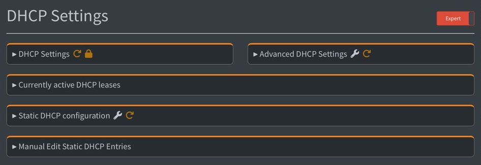

# Pi-hole Awesome-a-fyer

Two independent patches for the Pi-hole v6 web interface. **DHCP** lets you turn an active lease into a static reservation. **Query Log** groups repeated requests and shows how often each one occurred.

[awesome-a-fyer the dhcp page](#awesome-a-fyer-the-dhcp-page) · [awesome-a-fyer the queries page](queries.md)

## Get started

**[Open the copyable prompt](prompts/manage.md)** and paste the full block into your LLM.

1. Choose **DHCP**, **Query Log**, or **both**.
2. Choose **Check only**, **Install/update**, or **Undo**.
3. Give the LLM your Pi-hole Admin URL and usual SSH alias or command. It will identify the installation and check the selected patches against the files serving your UI.

Use **Check only** to see whether a newer patch is available. **Install/update** skips pages that are already current. **Undo** removes the installed revision for the pages you chose. [Browse the patch files](patches/README.md).

## awesome-a-fyer the dhcp page

- Open the page in Expert mode. Toggle each settings or lease section by its heading.
- Search, sort, and page through static reservations by IP address, hostname, or MAC address.
- Use **+** beside an eligible active lease to open an editable reservation draft. Select the checkmark to stage it for **Save & Apply**, or the curved arrow to cancel. The eye opens queries for that client.
- Confirm lease deletions and expand **Manual Edit Static DHCP Entries** for advanced configurations.

The top three devices already have static reservations. For any of the bottom three, select **+** to review and edit a new reservation.

*Both tables use fictional device names and network addresses.*

## Compatibility

The installer checks the actual web files before applying either patch. Run that check again after a Pi-hole update. The install prompt covers native systems, system containers, Docker or Podman, and managed deployments.

Pi-hole and its web interface are maintained by the [Pi-hole project](https://github.com/pi-hole/web).
