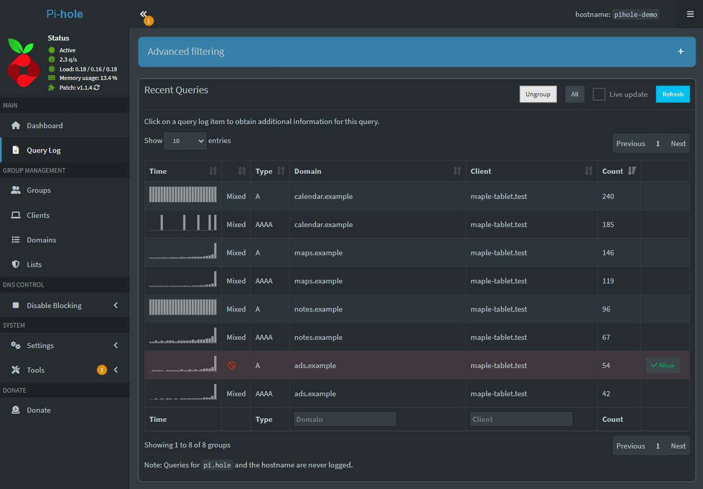
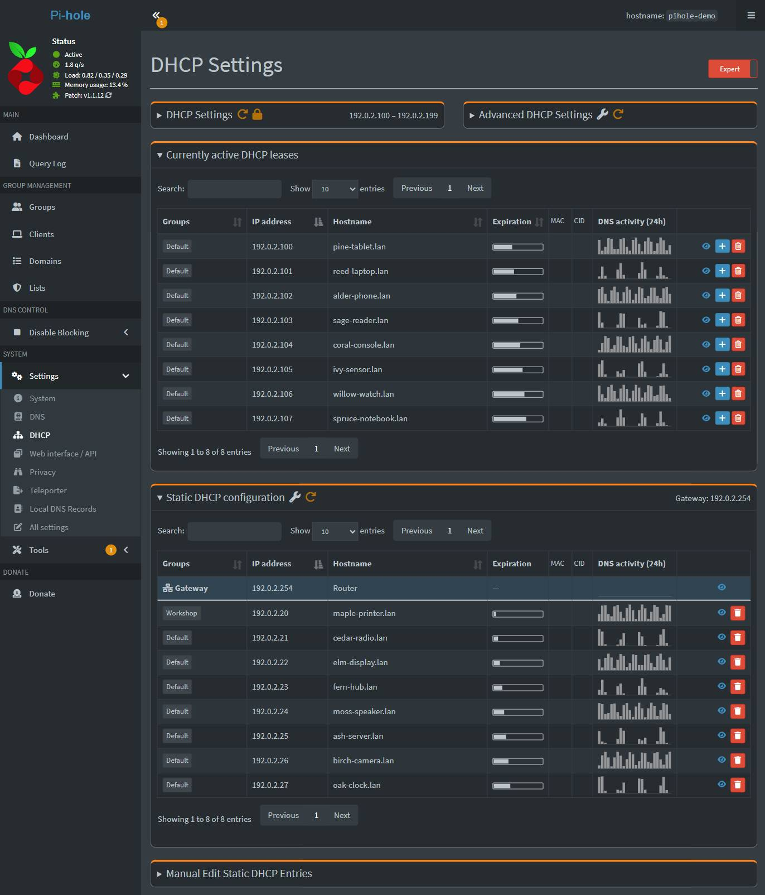

**The page patches change only the Pi-hole web UI. They use Pi-hole’s existing API when you save changes. I tweaked the layout to suit how I use Pi-hole. Maybe you’ll find it useful too.**

# pihole-aaf

Choose the Dashboard, Query Log, or DHCP patch for the Pi-hole v6 web interface. Install any combination.

[DNS service blocklists for Pi-hole and Logstalgia](blocklists/README.md)

## Install, update, or Undo to Stock

- Copy the [setup prompt](prompts/manage.md) into your AI assistant. Choose the action first.
- Choose the pages and features. Enter your Pi-hole address and SSH command. [Install options](prompts/manage.md#install-options)
- After a Pi-hole update, run **Check only** to see if you need to reapply the patches.

## Optional group pause

- Open **Disable Blocking** in the left sidebar. Check groups or select one device by IP, then choose a time below.
- **All devices** uses Pi-hole’s built-in timer. Selected groups use the same time controls and a small host service. [Setup and undo](group-pause/README.md)

## awesome-a-fyer the dashboard

- Select a heading to collapse or expand its box.
- Collapse **Top Permitted Domains** or **Top Blocked Domains** to see the full query count on the right.
- Collapse either **Top Clients** table to see the client count and responses. These use Pi-hole’s client rankings and query counters for that table.

## awesome-a-fyer the queries page

- Group requests by client, domain, and query type.
- Sort by count. See when requests occurred across 24 bars.
- Switch between **All**, **Blocked**, and **Allowed**. Keep the current client filter.
- **Reorderable columns.** Drag a header to move it. Your browser remembers the order.

[Query Log guide](queries.md)

## awesome-a-fyer the dhcp page

- Select the eye beside a device to open its Query Log.
- Active leases and static reservations are now grouped in separate tables. Collapse any section.
- Select **+** beside a lease to move it to the Static Table - edit it as the **New** row at the top. Press **Enter** or tap outside the row to save.
- Edit hostnames and groups in place. Use **Save & Apply** only for deletions.
- Tap **VND**, **MAC**, or **CID** to show or hide that column in both tables.
- Check lease time remaining and DNS activity for the past 24 hours.
- Add address history and guarded saves together. Follow a device's query history when its IP changes. Guard reservation edits against conflicts. This option needs DHCP and Query Log. [Address history and guarded saves](lease-handoffs/README.md)
- On Docker, the monitor, guard, and Nginx run inside the same Pi-hole container. [Docker setup](lease-handoffs/docker/README.md)
- **Reorderable columns.** Drag a header to move it. Your browser remembers the order.

[DHCP guide](dhcp.md)
