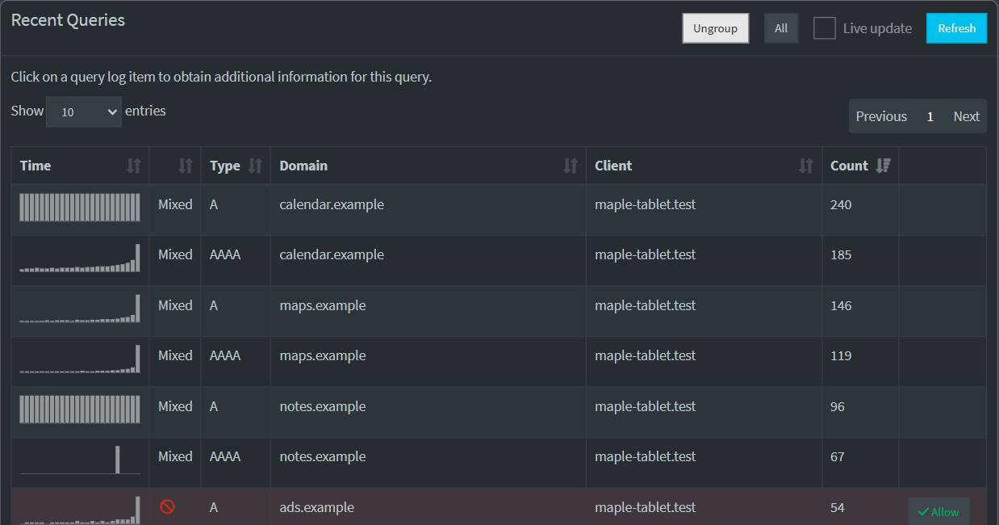

# Pi-hole awesome-a-fyer

Two optional patches for the Pi-hole v6 web interface. Install either page or both.

## Install, update, or undo

- Paste the [setup prompt](prompts/manage.md) into your AI assistant.
- Choose the pages and action. Enter your Pi-hole address and SSH command.
- After a Pi-hole update, run **Check only** to see if you need to reapply the patches.

## awesome-a-fyer the queries page

- Group requests by client, domain, and query type.
- Sort by count. See when requests occurred across 24 bars.
- Switch between **All**, **Blocked**, and **Allowed**. Keep the current client filter.
- **Reorderable columns.** Drag a header to move it. Your browser remembers the order.

[Query Log guide](queries.md)

## awesome-a-fyer the dhcp page

- Select the eye beside a device to open its Query Log.
- Active leases and static reservations are now grouped in separate tables. Collapse any section.
- Select **+** beside a lease to move it to the Static Table - edit it as the **New** row at the top. Select the checkmark to save.
- Edit hostnames and groups in place. Use **Save & Apply** only for deletions.
- Tap **MAC** or **CID** to show / hide the data
- Check lease time remaining and DNS activity for the past 24 hours.
- **Reorderable columns.** Drag a header to move it. Your browser remembers the order.

[DHCP guide](dhcp.md)
