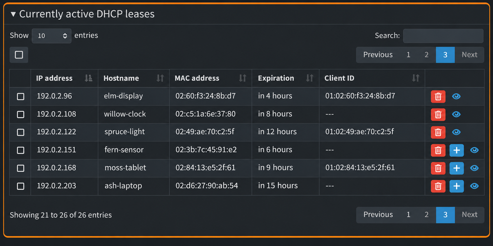
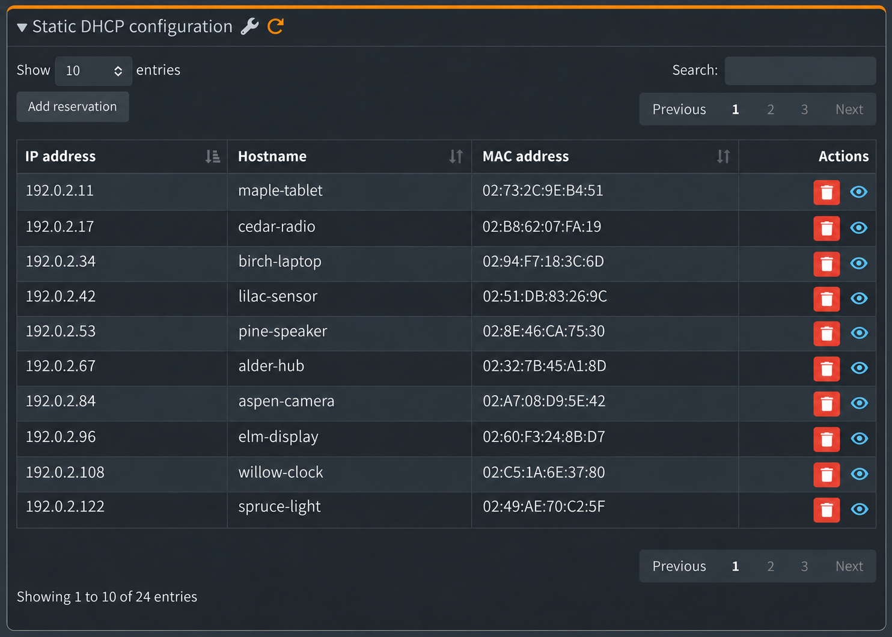

# Pi-hole Awesome-a-fyer

This project provides two independent patches for the Pi-hole v6 web interface. You can install either patch or both.

| Page | What you can do |
| --- | --- |
| [DHCP](#awesome-a-fyer-the-dhcp-page) | Tidy the DHCP page with collapsible boxes, and added functionality |
| [Query Log](queries.md) | Group repeated DNS queries and count requests from each client. |

## Get started

1. Copy the entire block from the [shared prompt](prompts/manage.md).
2. Paste it into your AI assistant.
3. Choose **DHCP**, **Query Log**, or **both**.
4. Choose an action from the table below.
5. Give the assistant your Pi-hole Admin URL and your usual SSH command or alias.

| Action | Result |
| --- | --- |
| **Check only** | Compares installed patches with GitHub. Leaves live files intact. |
| **Install/update** | Installs missing patches and updates older ones. Skips current patches. |
| **Undo** | Removes the installed patch from each selected page. |

## awesome-a-fyer the dhcp page

Select the eye beside an active lease or static reservation to see queries from that IP address.

The DHCP page opens in Expert mode. Select a section heading to expand or collapse it.

### Create a static reservation

1. Find the device under **Currently active DHCP leases**.
2. Select **+** to the right of the eye. A draft opens at the bottom of **Static DHCP configuration**.
3. Edit the draft. Select the checkmark to confirm it or the curved arrow to cancel it.
4. Select **Save & Apply** to save the confirmed reservation.

In this example, the top three devices already have reservations. The bottom three have a **+** button.

Search or sort reservations by IP address, hostname, or MAC address. To edit the entries as text, open **Manual Edit Static DHCP Entries**. Pi-hole asks for confirmation when you delete a lease or reservation.

*The tables show fictional devices and addresses.*

## Compatibility

The prompt covers native installations, system containers, Docker, Podman, and managed deployments. After a Pi-hole update, run **Check only** again. The update can replace the patched web files.

[Browse the patches](patches/README.md) · [Pi-hole web interface project](https://github.com/pi-hole/web)
