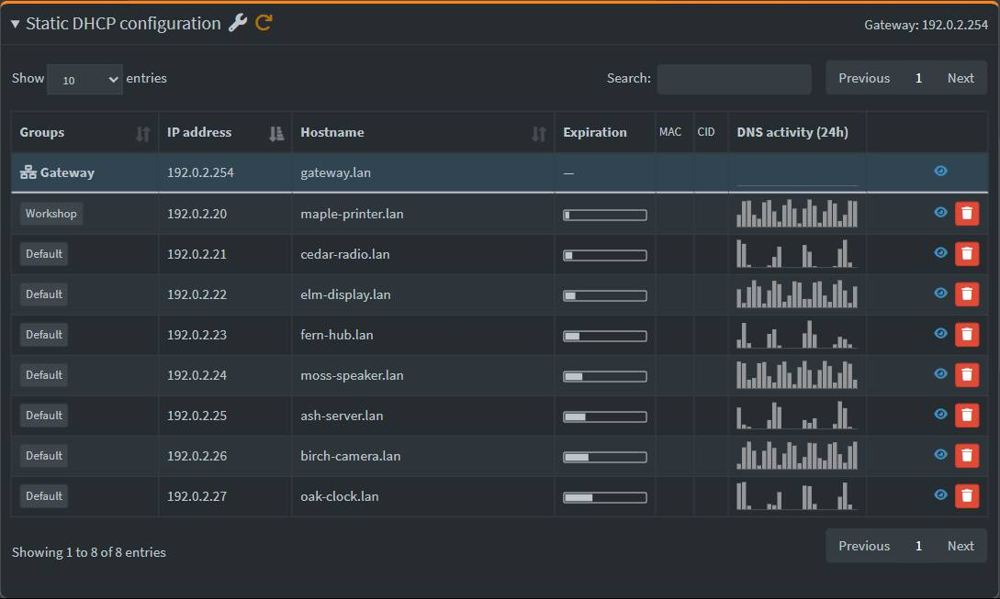

# Pi-hole awesome-a-fyer

This project provides two independent patches for the Pi-hole v6 web interface. You can install either patch or both.

| Page | What you can do |
| --- | --- |
| [Query Log](#awesome-a-fyer-the-queries-page) | Group repeated DNS queries and count requests from each client. |
| [DHCP](#awesome-a-fyer-the-dhcp-page) | Tidy the DHCP page with collapsible boxes, and added functionality |

## Get started

1. Copy the entire block from the [shared prompt](prompts/manage.md).
2. Paste it into your AI assistant.
3. Choose **DHCP**, **Query Log**, or **both**.
4. Choose an action from the table below.
5. Give the assistant your Pi-hole Admin URL and your usual SSH command or alias.

| Action | Result |
| --- | --- |
| **Check only** | Compares installed patches with GitHub. Leaves live files intact. |
| **Install/update** | Installs missing patches and updates older ones. Skips current patches. |
| **Undo** | Removes the installed patch from each selected page. |

## awesome-a-fyer the queries page

### Group repeated queries

When you filter by one client, its hostname appears in bold beside **Recent Queries**.

Select **Group** at the top of Recent Queries. Each row combines requests with the same domain, query type, and client IP. **Count** replaces reply time. It includes matching requests from all pages of the filtered results.

The **Time** chart divides the full query range into 24 equal intervals, from oldest to newest. For a six-hour range, each bar covers 15 minutes. For a two-day range, each bar covers two hours. An empty slot means zero queries. Hover over a slot to see its UTC interval and count.

In this fictional example, `maple-tablet.test` sent 240 A queries for `calendar.example` across the selected range. The 24 interval counts add up to 240. The next row shows the same client's 185 AAAA queries. Each chart scales to its own busiest interval. Use **Count** to compare totals across rows.

### Filter and inspect results

- Select the button beside **Group** or **Ungroup** to cycle through **All**, **Blocked**, and **Allowed**. Your client filter stays active.
- Select a group to inspect its latest query. **Mixed** means the queries in that group had different results.
- Select **Refresh** to include newer requests.
- Select **Ungroup** to see individual requests and their reply times.

To install the Query Log patch alone, choose **Query Log** in the [shared prompt](prompts/manage.md). Then choose **Install/update**.

[Query Log patch](patches/pihole-query-log-grouping.patch) · [Standalone Query Log guide](queries.md)

## awesome-a-fyer the dhcp page

The DHCP page opens in Expert mode. Select a section heading to expand or collapse it.

Select the eye beside an active lease or static reservation to see queries from that IP address.

### Create a static reservation

1. Find the device under **Currently active DHCP leases**.
2. Select **+** to the right of the eye. A draft opens at the bottom of **Static DHCP configuration**.
3. Edit the draft. Select the checkmark to confirm it or the curved arrow to cancel it.
4. Review the pending changes listed below **Save & Apply**, then select the button. It appears when there are changes to save.

Tap a MAC address in either DHCP table to copy it. **Copied** appears briefly. Tap a hostname in either table to edit it inline. As you type, spaces become underscores. The editor removes unsupported characters. To change a saved address, select the pencil in the reservation row.

Long client IDs appear in a tinted, read-only field. Tap once to copy the full ID. **Copied** appears briefly when the copy succeeds. If the browser blocks copying, the ID stays selected for manual copying.

Under **Currently active DHCP leases**, tap **Groups** in the far-left cell of a lease row to edit its membership. Select existing groups or enter a group name. Choose **Save groups** to assign them to that IP. Pi-hole creates the named group if it does not exist. The change takes effect separately from **Save & Apply**. If another device later gets this IP, it uses the same groups. If the lease could inherit an interface rule, the table shows **Check interface rule**.

Under **Currently active DHCP leases**, tap a hostname to edit it. In either table, press **Enter** to stage the name or **Esc** to discard it. Select **Save & Apply** to write staged changes. A dynamic lease keeps its dynamic address. The DHCP name takes effect when the client renews. Use the manual editor for advanced host rules.

In **Expiration**, the outline represents the configured lease time. The fill shows the time left. Hover or focus the bar for Pi-hole's usual wording, such as "in 3 hours" or "Never".

Drag a column header in either DHCP table to move it. Each table remembers its own layout in your browser. Hostname edits appear under **Save & Apply** as one change, such as **office-printer → studio-printer**.

In active leases, **Expiration** sits beside **Hostname**. **MAC** and **CID** start collapsed. Tap either header label to show or hide that column’s values.

The **DNS activity (24h)** column immediately after **Client ID** shows one hourly bar per active lease for the past day. Hover over a slot for its UTC interval and query count. An empty chart shows only the horizontal axis.

In this example, the top three devices already have reservations. The bottom three have a **+** button.

Search or sort static reservations by IP address, hostname, or MAC address. To edit the entries as text, open **Manual Edit Static DHCP Entries**. Pi-hole asks for confirmation when you delete a lease or reservation.

## Compatibility

The prompt covers native installations, system containers, Docker, Podman, and managed deployments. After a Pi-hole update, run **Check only** again. The update can replace the patched web files.

[Browse the patches](patches/README.md) · [Pi-hole web interface project](https://github.com/pi-hole/web)
