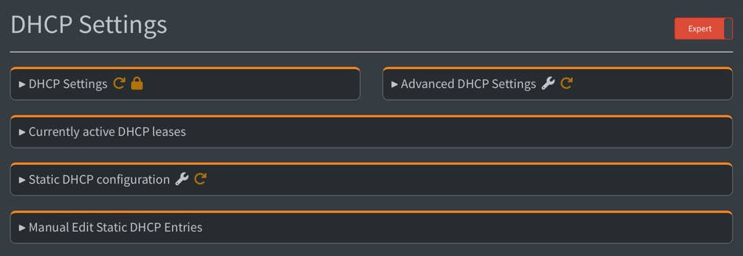
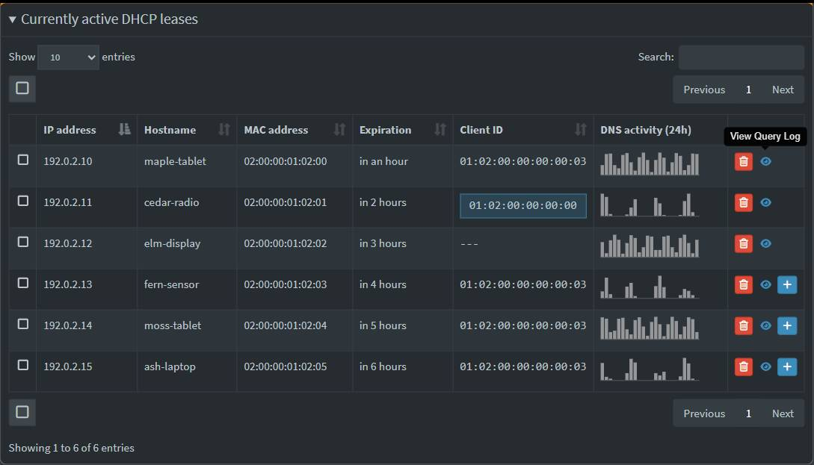
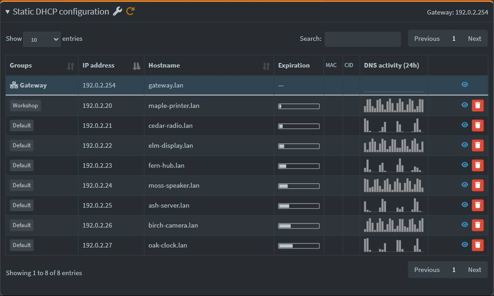

# awesome-a-fyer the dhcp page

The DHCP page opens in Expert mode. Select a section heading to expand or collapse it.

Select the eye beside an active lease or static reservation to see queries from that IP address.

### Create a static reservation

1. Find the device under **Currently active DHCP leases**.
2. Select **+** to the right of the eye. An outlined row marked **New** opens at the top of **Static DHCP configuration**.
3. Edit the draft. Press **Enter** or tap outside the row to save. Select the curved arrow to cancel.

Both tables show a matching DNS suffix when Pi-hole reports one for the device. For example, a DHCP name of **printer** can appear as **printer.lan**. The editor opens the stored DHCP name.

Tap a MAC address in either DHCP table to copy it. **Copied** appears briefly. Tap a hostname in either table to edit it inline. As you type, spaces become underscores. The editor removes unsupported characters. To change a saved address, select the IP address in the reservation row.

Long client IDs appear in a tinted, read-only field. Tap once to copy the full ID. **Copied** appears briefly when the copy succeeds. If the browser blocks copying, the ID stays selected for manual copying.

Tap the group in the far-left cell to edit membership. **Inferred** marks a match based on a subnet, MAC address, or DNS name. If Pi-hole cannot determine the interface rule, the table shows **Check interface rule**. **Paused** marks an active device override. Resume it in the sidebar before editing its groups.

Select existing groups or enter a name. Choose **Save groups** to write an IP rule. Pi-hole creates the named group if it does not exist. The IP rule takes precedence over inherited groups. If DHCP gives the address to another device, that device uses the same rule.

Use one browser session for reservation edits. Refresh if Pi-hole reports a conflict. A single addition or deletion changes just that entry. Renames and batches still use a whole-list update.

Under **Currently active DHCP leases**, tap a hostname to edit it. In either table, press **Enter** or tap outside the field to save the name. Press **Esc** to discard it. A dynamic lease keeps its dynamic address. The DHCP name takes effect when the client renews. Use the manual editor for advanced host rules.

In **Expiration**, the outline represents the configured lease time. The fill shows the time left. Hover or focus the bar for Pi-hole's usual wording, such as "in 3 hours" or "Never".

Drag a column header in either DHCP table to move it. Each table remembers its own layout in your browser.

The **Static DHCP configuration** heading shows the configured gateway address. Pi-hole reads this address from its DHCP router setting. The table pins the router above all reservations, even when you search, sort, or change pages. Look for the network icon and **Gateway** in the Groups column. The hostname cell shows the name Pi-hole knows for the gateway, or its hardware vendor when available. Tap it to save a display label for this browser. Clear the label and save to restore the detected value. The row has a Query Log link. It has no delete button.

The collapsed **DHCP Settings** heading shows the current address range. **Vendor** follows **Hostname** in both tables. Tap **VND** to see the hardware manufacturer from Pi-hole’s network records. A dash means the vendor is unknown. **VND**, **MAC**, and **CID** start collapsed. The table keeps its width when you expand **VND**. Tap a heading to show or hide its data in both tables. Corresponding columns have the same width.

The **DNS activity (24h)** column immediately after **Client ID** shows one hourly bar per active lease for the past day. Hover over a slot for its UTC interval and query count. An empty chart shows only the horizontal axis.

The upper table shows active leases without a reserved IP address. The static table shows configured IP reservations, including offline devices. Both tables have the same columns. A dash under **Expiration** means the reservation has no active lease. Host rules without a fixed IP remain in **Manual Edit Static DHCP Entries**.

Both tables have one row of controls. Choose the number of entries on the far left. Search and page controls sit together on the far right. Search static reservations by IP address, hostname, or MAC address. Select the IP address or hostname heading to sort. To edit the entries as text, open **Manual Edit Static DHCP Entries**. Confirm a deletion to queue it. Review the list under **Save & Apply**, then select the button to delete the listed entries. Other DHCP edits apply when you finish the field or confirm the row.

[Compare stock and patched DHCP with the before-and-after slider](https://micassa-pics.github.io/pihole-awesome-a-fyer/comparison/#dhcp)

The sidebar shows the installed patch version below **Memory usage**. Select the circular arrow to check the installed pages against the shared release version. The checker opens in a new tab.

[DHCP patch](patches/pihole-dhcp-table.patch) · [Back to the README](README.md)
