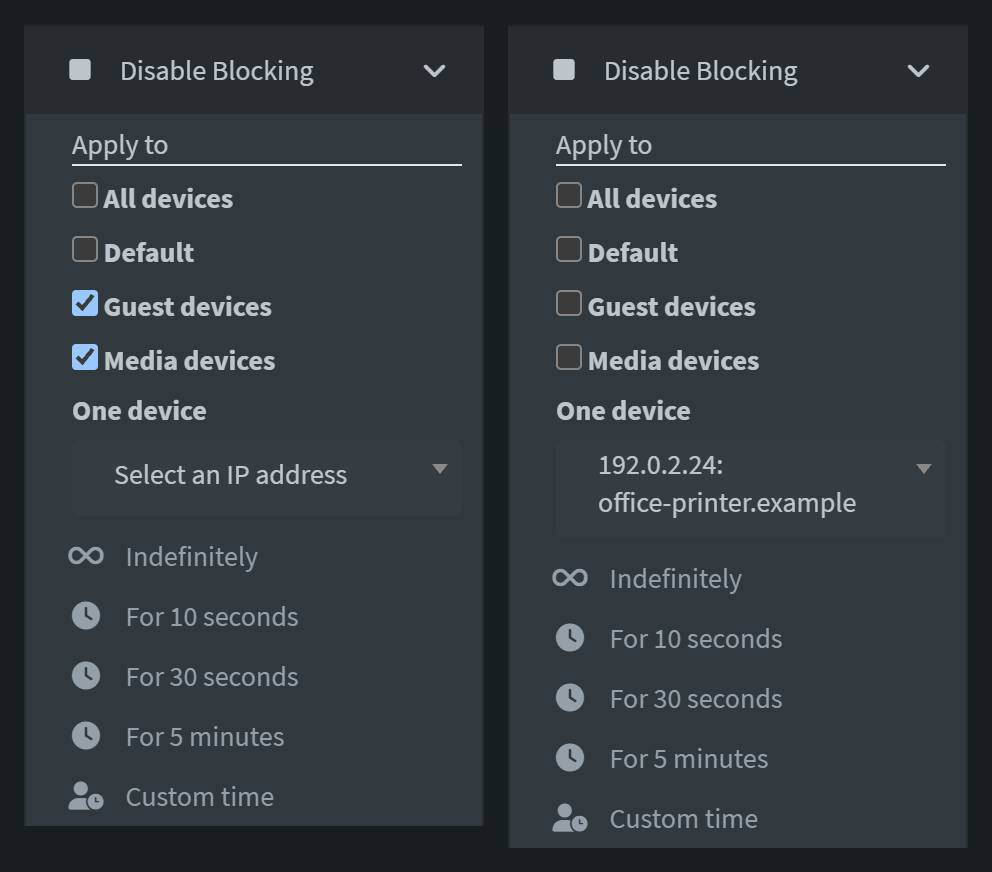

# Pause blocking for selected groups

Timer service version **1.2.0**. The sidebar and worker use a reload receipt to report whether a pause took effect before its deadline.

Open **Disable Blocking** in the left sidebar. Check one or more groups under **Apply to**. For one address, select **One device** instead. The dropdown lists known IPv4 and IPv6 addresses in numeric order. Each address ends with a colon. Its hostname appears on the next line when available. The picker hides loopback addresses unless one has a pause you can resume. Select a time below the list. **Custom time** uses the existing seconds and minutes dialog. Select **All devices** for Pi-hole’s normal network-wide pause.



The host service restores the selected groups after the timer expires. You can close the browser. If the host restarts, the service restores overdue groups when it starts again. **Indefinitely** keeps a group disabled until you enable it on the Groups page. Rules from other enabled groups still apply to their members.

A device pause applies to the selected IP. Other addresses on the same device keep their rules. The worker temporarily assigns that exact IP to an empty group. At expiry it restores the previous memberships or removes the temporary client rule. Select a paused IP and tap **Resume this IP** to end its pause early.

If an administrator deletes a pause marker, the worker reconciles the timer. If someone adds a comment to a temporary client during a pause, the worker archives it in `client_notes` in its timer database before removing the temporary override. Explicit changes to group membership take precedence.

## Install on systemd

Use stock Pi-hole Web v6.6.1 or a version where the loader patch passes its apply check. This optional component works independently of the page patches.

1. Identify the admin webroot and the actual gravity database. For Docker, find the host mount that supplies the database. For a native install, the default path is `/etc/pihole/gravity.db`.
2. Create an empty, root-owned directory at `/usr/local/lib/pihole-group-pause/root` (mode 0755). Install `worker.py` and `reload.py` in `/usr/local/lib/pihole-group-pause/`. Install the three systemd units under `/etc/systemd/system/`. Set `User`, `Group`, and `SocketUser` to match the non-root database owner's UID and GID. On upgrade, transfer ownership of the timer state directory and existing state files to the worker. Keep one worker per database.
3. Set the writable `/gravity` bind source to a dedicated gravity directory. This directory must contain only the gravity database and its SQLite support files. Stop Pi-hole before copying its database. Point FTL at the new path. Keep the previous database and service files for rollback. Set the helper's log path to the running instance's host-side FTL log path. Set the container name. For native Pi-hole, omit `--container` and set `CapabilityBoundingSet=CAP_KILL` in the reload helper so it can signal FTL.

4. Start the service with the following commands on the Linux host.

```sh
sudo systemctl daemon-reload
sudo systemctl enable group-pause.service
sudo systemctl restart group-pause.service
sudo systemctl status group-pause.service
```

5. Back up `scripts/lua/footer.lp` in the webroot. Copy `group-pause.js` to `scripts/js/group-pause.js`. From the webroot, run these commands with the absolute patch path.

```sh
git apply --check /path/to/sidebar-loader.patch
git apply /path/to/sidebar-loader.patch
```

6. Reload the admin page. Test a short pause on a group with no clients or rules. Confirm it becomes enabled again with the browser closed. For containers, include the loader and script in a mount or derived image to keep them after recreation.

## Install or update on OpenWrt

1. Identify the Docker stack and confirm its container serves DNS. The included init script assumes `/opt/docker/stacks/pihole` and the service name `pihole`. Adjust the paths and the fixed reload command for your setup. Install Python with SQLite and ctypes support and install socat.
2. Back up the deployment, gravity database and timer state. Resume old pauses before migration. Stop the old worker and Pi-hole. Copy the gravity database with SQLite backup or a clean offline copy. Place it in a dedicated directory called `gravity` beside the Compose file. Use the same UID and GID as the original database and keep the directory writable by that owner.
3. Mount `./gravity:/etc/pihole-gravity` in Compose. Set `FTLCONF_files_gravity` to `/etc/pihole-gravity/gravity.db`. Start Pi-hole. Confirm the active path and verify DNS and DHCP. Keep the previous Compose file and offline database until you verify recovery.
4. Install `worker.py`, `launch.py`, `reload.py` and `openwrt-reload` in the root-owned `/usr/lib/pihole-pause` directory. Name the last file `reload` and make it executable. Install executable `openwrt.init` as `/etc/init.d/pihole-pause`. Keep the log path in the reload launcher aligned with the stack's host-side FTL log mount.
5. Enable the init service and start it. Verify its status and confirm the worker filesystem contains the dedicated gravity directory, timer state, and local reload socket. Apply the same sidebar loader and script from the systemd section. Verify a short fixture pause and expiry.
6. When moving between hosts, confirm the former worker cannot target the active database. Once the replacement works, stop and disable the old timer service on the former host.

## How it works

The picker uses Pi-hole’s existing disable function, presets, and custom duration. For selected groups, the browser submits a short-lived, disabled request group through the authenticated Groups API. The worker consumes that request, checks each selected group, and pauses the selection in one database transaction. It records deadlines in its own SQLite file and asks the local socket helper to reload the lists. The worker has no access to the Docker socket. It retries failed reloads. The sidebar waits for a matching reload receipt before it confirms success. The worker opens no network port and needs no stored Pi-hole password.

Reserve the group-name prefixes `awesome-a-fyer-pause-`, `awesome-a-fyer-device-`, and `awesome-a-fyer-done-` for the worker. A request can appear briefly on the Groups page. A request older than 15 seconds expires without starting a pause. If the browser cannot confirm a pause, check the Groups page and the service log.

## Undo

1. Keep the sidebar and worker running. Use **Resume this IP** for each indefinite device pause. Resume timed device pauses or let them expire. On the Groups page, re-enable groups that you paused indefinitely. Verify that the affected clients have their original policy.
2. Check that `timers`, `device_timers`, `reload_pending`, and `receipts` in the worker’s database are empty. Reverse the loader patch in the webroot. Check it with `git apply --reverse --check` first. Remove `scripts/js/group-pause.js`.
3. On systemd, disable and stop `group-pause.service`, then stop `group-pause-reload.socket`. Remove the three unit files and the worker, then run `systemctl daemon-reload`. On OpenWrt, stop and disable `/etc/init.d/pihole-pause`, then remove the init file and its root-owned scripts. Keep the timer database with your backup. Keep the active gravity path in Compose unless you migrate the database back during a separate maintenance window.
