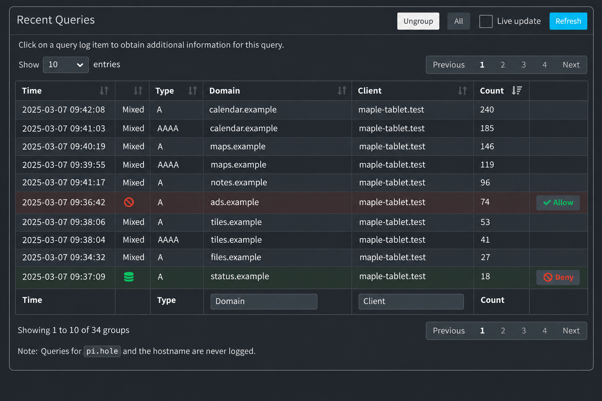

# awesome-a-fyer the queries page

Open **Query Log** from the Pi-hole sidebar. If you also installed the DHCP patch, the eye beside an active lease opens queries for that client.

In this fictional example, the same client made 240 A queries and 185 AAAA queries for `calendar.example`. Each query type gets its own row.

- **Group** combines requests with the same domain, query type, and client IP across all pages of the filtered results. **Count** replaces reply time and shows how many requests each row represents.
- The button beside **Group** cycles through **All**, **Blocked**, and **Allowed**. It works in both views and keeps the selected client filter.
- Select a grouped row to inspect its latest matching query. **Mixed** means the requests in that group had different results.
- Select **Refresh** to include newer requests, or **Ungroup** to return to individual requests and their reply times.

To install just this feature, choose **Query Log only** in the [install prompt](prompts/install.md).

[Query Log patch](patches/pihole-query-log-grouping.patch) · [Undo prompt](prompts/undo.md) · [Back to the README](README.md)
