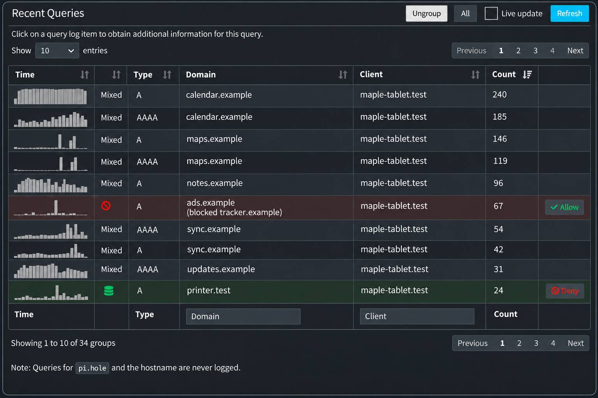

# awesome-a-fyer the queries page

Open **Query Log** from the Pi-hole sidebar. If you also use the DHCP patch, select the eye beside a lease to see that client's queries.

## Group repeated queries

Drag a Query Log header to move its column. Your browser remembers the layout for both individual and grouped queries.

When you filter by one client, its hostname appears in bold beside **Recent Queries**.

Select **Group**. Each row combines requests with the same domain, query type, and client IP. **Count** replaces reply time. It includes matching requests from all pages of the filtered results.

The **Time** chart divides the full query range into 24 equal intervals, from oldest to newest. For a six-hour range, each bar covers 15 minutes. For a two-day range, each bar covers two hours. An empty slot means zero queries. Hover over a slot to see its UTC interval and count.

In this fictional example, `maple-tablet.test` sent 240 A queries for `calendar.example` across the selected range. The 24 interval counts add up to 240. The next row shows the same client's 185 AAAA queries. Each chart scales to its own busiest interval. Use **Count** to compare totals across rows.

## Filter and inspect results

- Select the button beside **Group** or **Ungroup** to cycle through **All**, **Blocked**, and **Allowed**. Your client filter stays active.
- Select a group to inspect its latest query. **Mixed** means the queries in that group had different results.
- Select **Refresh** to include newer requests.
- Select **Ungroup** to see individual requests and their reply times.

To install the Query Log patch alone, choose **Query Log** in the [shared prompt](prompts/manage.md). Then choose **Install/update**.

[Query Log patch](patches/pihole-query-log-grouping.patch) · [Back to the README](README.md)
